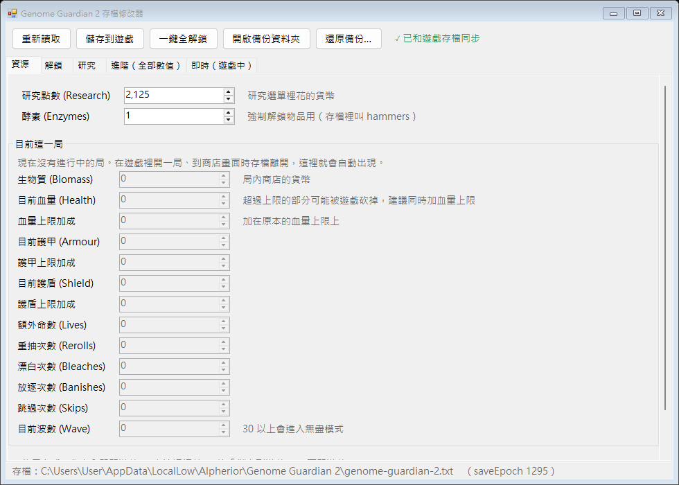
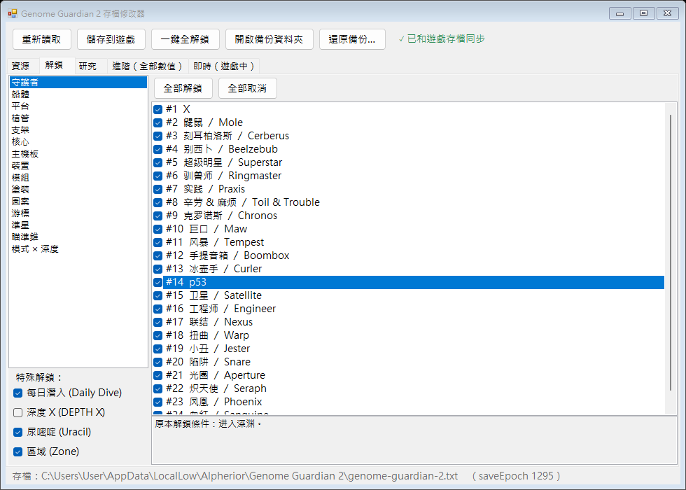
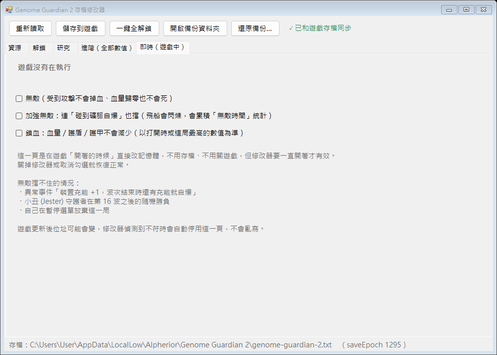
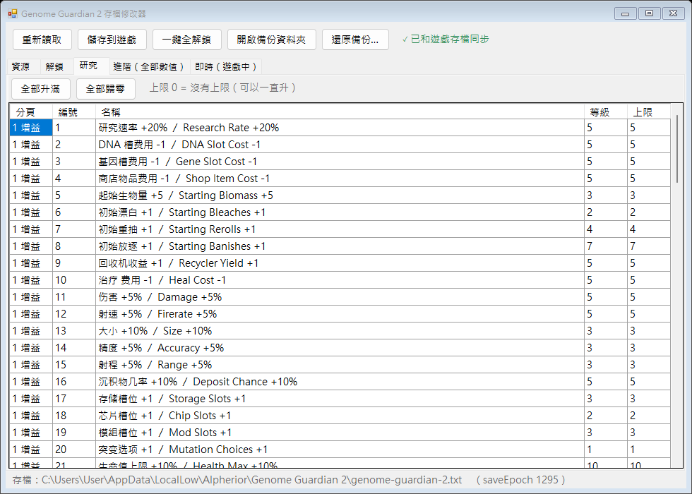
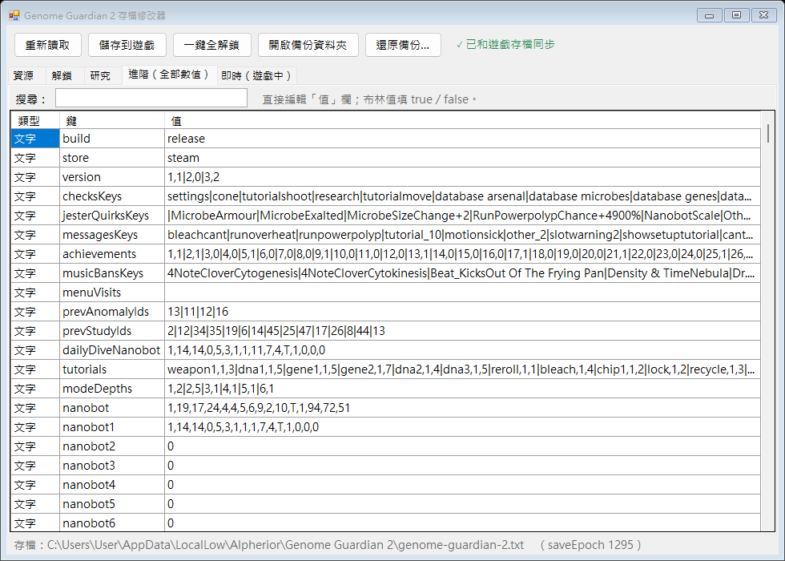

# Genome Guardian 2 修改器

[English README](README.en.md)

給 Steam 單機遊戲 **Genome Guardian 2** 用的修改器，分成兩個部分：

- **存檔修改**：遊戲關著的時候，調整研究點數、酵素、解鎖、研究等級、目前這一局的生物質和血量，也能直接改存檔裡的任何數值。
- **即時無敵**：遊戲開著的時候，直接打開無敵或鎖住血量，不用存檔也不用重開遊戲。

> 這是非官方的玩家自製工具，和開發者 Alpherior 沒有任何關係。只能用在單機遊戲上，使用風險自負。遊戲名稱和遊戲內文字的版權屬於 Alpherior。



## 功能

| 分頁 | 內容 |
|---|---|
| 資源 | 研究點數 (Research)、酵素 (Enzymes)；「目前這一局」：生物質、血量／護甲／護盾和它們的上限加成、額外命數、重抽、漂白、放逐、跳過、波數 |
| 解鎖 | 守護者、船體、平台、槍管、支架、核心、主機板、裝置、模組、塗裝、圖案、游標、準星、瞄準錐、每個模式的深度 1～5，還有每日潛入、深度 X、尿嘧啶、區域。名稱是遊戲內的簡體中文和英文；選取一個項目可以看它原本的解鎖條件，再點一下或按空白鍵切換勾選 |
| 研究 | 每一項研究的等級，「全部升滿」不會超過遊戲規定的上限 |
| 進階（全部數值） | 存檔裡的每個數值都能直接修改，可以用鍵名搜尋；改到危險欄位前會先警告 |
| 即時（遊戲中） | 無敵、加強無敵、鎖血（血量／護盾／護甲不會減少） |

上方的「一鍵全解鎖」會把存檔裡列出的所有項目都解鎖，並把有上限的研究升滿（上限 0 = 沒有上限的研究維持原樣）。

| 解鎖 | 即時（遊戲中） |
|---|---|
|  |  |

| 研究 | 進階（全部數值） |
|---|---|
|  |  |

## 下載和使用

需要 64 位元的 Windows 10（1903 以後）或 Windows 11（使用內建的 .NET Framework 4.8，不用另外安裝）。

1. 到 [Releases](../../releases) 下載 zip，解壓縮後執行 `GG2修改器.exe`。
2. 它會自動找到存檔：`%USERPROFILE%\AppData\LocalLow\Alpherior\Genome Guardian 2\genome-guardian-2.txt`。

exe 沒有數位簽章，而且「即時」功能會寫入遊戲的記憶體，Windows SmartScreen 或防毒軟體可能會跳警告。

### 改存檔（資源、解鎖、研究、進階）

1. **先完全關閉遊戲**（遊戲開著時修改器不讓你存，因為遊戲關閉時會用記憶體裡的資料把存檔蓋掉）。
2. 在修改器裡調整。
3. 按「儲存到遊戲」，再開遊戲。

「目前這一局」只有在有進行中的局時才能改：在遊戲裡開一局，到商店畫面時離開遊戲，修改器就會自動讀到。有未儲存的修改時不會自動重新讀取，請按「重新讀取」。如果遊戲在你修改期間又存過檔，按儲存時會先詢問，避免舊資料蓋掉新進度。

每次儲存前，原本的存檔會自動備份到 exe 旁邊的 `存檔備份` 資料夾（按「開啟備份資料夾」可以打開）。改壞了就按「還原備份…」選一個資料夾救回來；還原前也會先把當時的存檔另外備份一份。

### 即時無敵

1. 開著遊戲，打開修改器，切到「即時（遊戲中）」。
2. 勾選「無敵」。上方會顯示目前的波數和血量。
3. 修改器要一直開著才有效；取消勾選或關掉修改器就恢復正常。

| 開關 | 效果 |
|---|---|
| 無敵 | 受到攻擊不會掉血，血量歸零也不會死。用的是遊戲內建的無敵旗標，不會閃爍也不會累積統計 |
| 加強無敵 | 連「碰到礦脈自爆」也擋得住；飛船會閃爍，會累積「無敵時間」統計 |
| 鎖血 | 血量、護盾、護甲不會減少：以勾選後（或這局開始後）出現過的最高值為準，每 0.1 秒補回一次。一擊致命時仍然可能死亡，建議搭配無敵 |

無敵擋不住的情況：異常事件「裝置充能 +1，波次結束時還有充能就自爆」、小丑 (Jester) 守護者第 16 波之後的隨機勝負、自己在暫停選單放棄這一局。

## 注意事項

- **會解開 Steam 成就**：遊戲每次讀檔都會檢查成就，用修改器解鎖的東西可能會讓你的 Steam 帳號直接解開對應的成就，無法撤回。
- **Steam 雲端存檔**：改完開遊戲時，如果 Steam 問要用哪個存檔，選「本機」的。
- **遊戲更新**：解鎖、研究、進階一般不受影響。「目前這一局」的欄位位置、名稱表和「即時」分頁的記憶體位址，都是依 Steam build 25938646 分析的，遊戲更新後可能對不上。「即時」分頁連上遊戲時會核對類別名稱，不符就停止寫入並顯示警告；「目前這一局」沒有自動偵測。
- 「深度 X」等特殊解鎖會由遊戲重新判定，改了不一定會保留。
- 「進階」分頁裡的 `fresh`、`build`、`dev`、`modeId`、`saveEpoch`、`version`、劇情進度、`nanobot*`、`runSave` 改錯可能會重置存檔、讀檔失敗改讀備份、讓這一局作廢、劇情跳躍，或打開能清掉所有 Steam 成就的開發者主控台；修改器會先跳警告。

## 自己編譯

只用 C# 5 語法，用 Windows 內建的編譯器就能建置。雙擊：

```bat
src\build.bat
```

會在專案資料夾產生 `GG2修改器.exe`。

| 檔案 | 內容 |
|---|---|
| `src/GG2Editor.cs` | 存檔讀寫、整個介面，以及「即時」分頁的記憶體位址和邏輯 |
| `src/GameMemory.cs` | 讀寫其他程式記憶體的通用工具 |
| `src/names.json` | 物品、研究、模式的名稱、效果說明、原本解鎖條件和研究等級上限（取自遊戲本體的簡體中文和英文；編譯時內嵌進 exe） |

## 運作原理

**存檔**：`genome-guardian-2.txt`（另有 `-backup`、`-rescue` 兩份）是 JSON 的每個位元組和 ASCII 金鑰 `alphakenneth` 循環 XOR 的結果。JSON 分成 `StringData`、`IntData`、`FloatData`、`BoolData` 四區，每區是 `{"Key":…,"Value":…}` 的清單。存檔沒有校驗碼或簽章，只要 JSON 正確、`saveEpoch` 大於 0 就能讀。修改器寫回時會保持原本的格式（沒修改時和原檔逐位元組相同），三份存檔寫入一樣的內容，`saveEpoch` 加 1。

**即時無敵**：遊戲判斷能不能受傷的 `Nanobot.Damageable()` 會先看一個靜態旗標 `Test.runInvincible`，同一個旗標也會跳過血量歸零的死亡判定。修改器每 0.1 秒把它設為 true。飛船本身的 `invulnerable` 布林值每一幀都會被遊戲重新計算，所以不能直接改它；「加強無敵」改的是 `invulnerableTime` 計時器。
